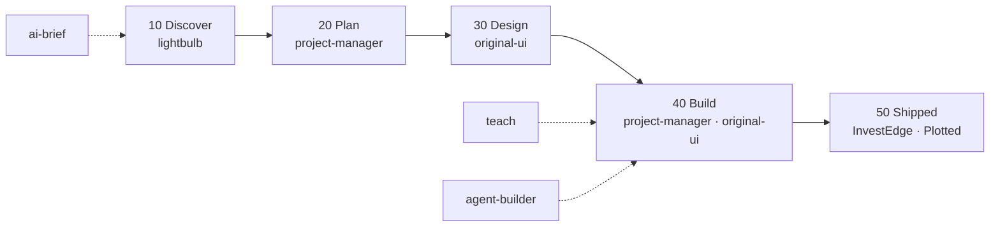

### Hi, I'm Anay.

I build ML systems for finance, and the AI toolkit I use to ship them.

Data Science Associate at [Wio Bank](https://www.wio.io/) and MS Business Analytics & AI candidate at UT Austin. I work on credit scoring, transaction intelligence, and LLM assistants whose every number traces back to real data. Off the clock, I design Claude skills that take an idea to a shipped product: plan, design, build, verify.

**[Portfolio](https://anaypatel-p.github.io)** · [Resume](https://anaypatel-p.github.io/resume.pdf) · [LinkedIn](https://www.linkedin.com/in/anay-patel26/) · [anay.patel1118@gmail.com](mailto:anay.patel1118@gmail.com)

## Selected work

| Project | What it is | Status |
|---|---|---|
| **[InvestEdge](https://github.com/AnayPatel-P/investedge)** | Forecasting, honestly. Runs ARIMA, ETS, Prophet and GARCH on every S&P 500 stock, then replays a year of old forecasts against what really happened. Nightly pipeline → DuckDB → static React app, plus an optional Claude tutor that looks numbers up instead of guessing. [Live demo](https://anaypatel-p.github.io/investedge/) | **Live** |
| **[Plotted](https://github.com/AnayPatel-P/plotted)** | Plan your degree semester by semester against your school's real catalog. Python scrapers → rule trees → a TypeScript requirement and prerequisite engine in the browser; Next.js + Supabase. Lighthouse 100, 0 axe violations. [Live app](https://plotted-cyan.vercel.app) | **Live** |
| **[MarketLens](https://github.com/AnayPatel-P/MarketLens)** | Real-time stock watchlist: FastAPI REST + WebSockets, React/TypeScript, TradingView charts, Docker Compose. Being rebuilt with a volatility-forecasting component. | Rebuilding |

## How I build with AI

I write Claude skills: reusable workflows with phases, gates, output contracts and guardrails. InvestEdge, Plotted and my portfolio site were planned with **project-manager** and designed with **original-ui**.

| Skill | What it does |
|---|---|
| **lightbulb** | Evidence-based idea generation: mines Reddit, HN, forums and reviews for real complaints, checks each against existing products, and ranks the gaps. No idea makes the report without evidence links. |
| **project-manager** | Takes a raw idea to a shipped product through gated phases: clarifying questions, a MoSCoW-prioritized PRD, a roadmap where every phase ends in a demo, then build with check-ins and a change-request flow. |
| **original-ui** | Interviews for the feel you want, researches real interfaces, and combines them into an original concept, then holds it to Apple-grade craft: hierarchy, interruptible motion, designed states, accessibility. |
| **agent-builder** | Turns a task into a well-built agent: focused role, a system prompt with an output contract, least-privilege tools, the right model, and test cases that prove it works. |
| **teach** | A tutor with three modes: a quick briefing, a project-ready deep dive, or guided questions that map what you know first. |
| **ai-brief** | My daily AI newsletter: three scout sub-agents each sweep one beat and verify every item against a primary source, then the skill writes an issue with a concept, an exercise and a paper explained. |

## Background

- **Wio Bank**, Data Science Associate (2024–now) and ML Intern: financial-health scoring, an 8-tier transaction-categorization cascade, an AI finance assistant with a number-fidelity layer, XGBoost credit scoring
- **The Estée Lauder Companies**, CEO Presidential Associate Intern, Data Science: NLP sentiment + sales forecasting, price-elasticity modeling
- **UT Austin**: MS Business Analytics & AI (May 2028) · BS Mathematics, Statistics & Data Science minor (May 2026)

## Toolbox

**Modeling:** Python, PyTorch, scikit-learn, XGBoost, pandas, statistical modeling, time-series forecasting, Bayesian inference 
**Systems:** FastAPI, Docker, Kafka, MongoDB, SQL, Delta Lake, DuckDB, Azure, Git 
**AI:** Claude API & Agent SDK, tool use, guardrails & number fidelity, evals, Claude Code skills & subagents 
**Languages:** Python, R, SQL, TypeScript, C++, C#
